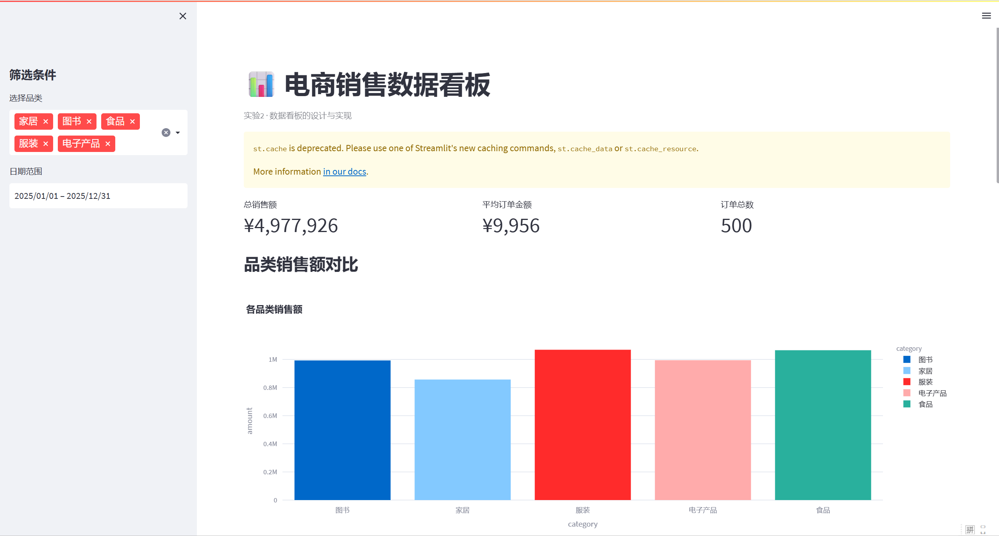

# data-dashboard-lab
# 实验2 数据看板的设计与实现

## 一、 实验信息
*   **姓名 / 学号**：[填写你的姓名和学号]
*   **业务场景**：电商销售数据看板

## 二、 实验任务完成情况

### 1. 基础任务
*   **需求与布局**：页面分为数据概览区（卡片）、维度统计区（柱状图）、趋势分析区（折线图）、明细数据区（表格）。
*   **数据预处理**：使用 Pandas 生成并清洗了 500 条模拟电商销售数据，剔除了空值和异常值。
*   **图表选型**：
    *   使用 `st.metric` 展示总销售额、平均订单金额、订单总数。
    *   使用 Plotly 绘制了分类对比柱状图、时间趋势折线图和占比饼图。
*   **整合实现**：使用 Streamlit 的 `layout="wide"` 完成了宽屏排版和组件整合。

### 2. 进阶与扩展任务（加分项）
*   **进阶2（联动与筛选）**：在侧边栏使用了 `st.multiselect` 和 `st.date_input` 实现了品类和日期的多条件筛选。筛选后，所有图表和指标卡片同步动态更新。

## 三、 看板效果截图

## 四、 实验中遇到的问题与解决
1.  **中文乱码问题**：读取 CSV 文件时使用了 `utf-8-sig` 编码，解决了可能的中文乱码问题。
2.  **环境版本兼容性**：最初使用的 Python 3.7 环境导致 Plotly 部分高级参数无法渲染（白屏），通过精简代码并回退到兼容性更好的基础图表写法，成功解决。
